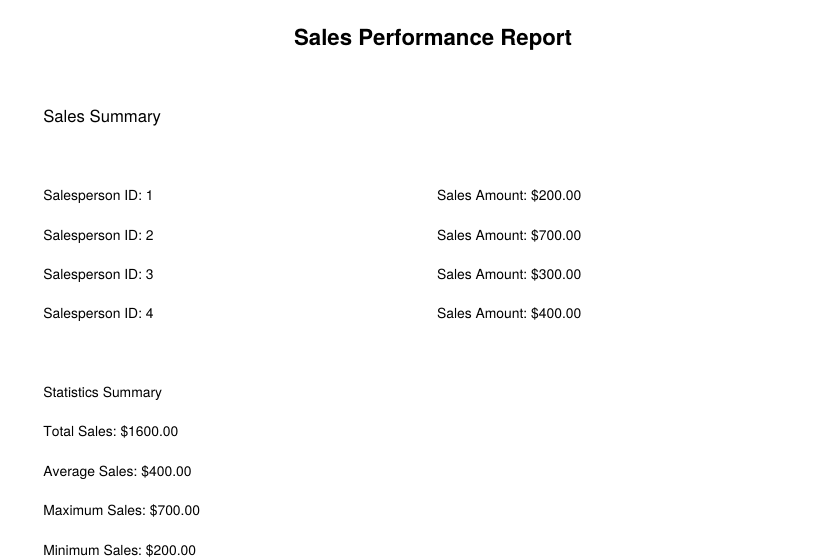

# 🏆 CMA Performance Pro: Sales Performance Analyzer


> A desktop app for sales managers. Record each salesperson's sales, find who's beating or missing target, chart the team's performance, and export a **PDF report** in one click.

## ✨ Features

| | Feature | What it does |
|---|---|---|
| ➕ | **Add Sales Data** | Records sales for a salesperson ID. Sales for an existing ID are **added to their total**, with a timestamp. |
| 🗑️ | **Delete Row** | Removes a salesperson from the table |
| 💾 | **Save / Restore Data** | Saves the table to `sales_data.txt` and loads it back later |
| 📊 | **Calculate Statistics** | Total, average, highest and lowest sales |
| 🎯 | **Salespersons Exceeding Target** | Counts how many people beat a target you enter |
| ⚠️ | **Underperforming Salesperson** | Lists everyone below the target, with their figures |
| 📈 | **Plot Sales Data** | Bar chart of sales by salesperson (Matplotlib) |
| 📄 | **Generate PDF Report** | Exports a formatted summary with statistics (FPDF) |

A status bar at the bottom confirms each action.

### Sample PDF output

<p align="center"></p>

## 🚀 Getting started

```bash
git clone https://github.com/kfahchai/CMA-PERFORMANCE-PRO.git
cd CMA-PERFORMANCE-PRO
pip install matplotlib fpdf
python main.py
```

Click **Restore Data** to load the sample data in `sales_data.txt`.

## 🏗️ Architecture

The code is split into three layers, so the business logic can be tested without opening the GUI:

```
main.py              # ▶ Entry point
├── sales_ui.py      # Presentation: Tkinter window, Treeview table, dialogs (SalesUI class)
├── sales_data.py    # Business logic: storage, statistics, target checks (SalesDataManager class)
└── sales_graphics.py   # Output: Matplotlib chart + FPDF report generation
```

Save-file format (`sales_data.txt`), one salesperson per line:

```text
<salesperson_id>, <sales_amount>, <YYYY-MM-DD HH:MM:SS>
```

## 📚 Key concepts

Object-oriented design · Layered architecture (UI / logic / output) · File persistence · Descriptive statistics · Data visualisation · PDF generation

---

<sub>Made by **Kean Fah Chai** · Swinburne University of Technology Sarawak</sub>
